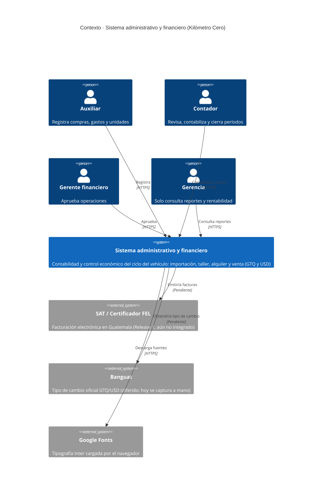
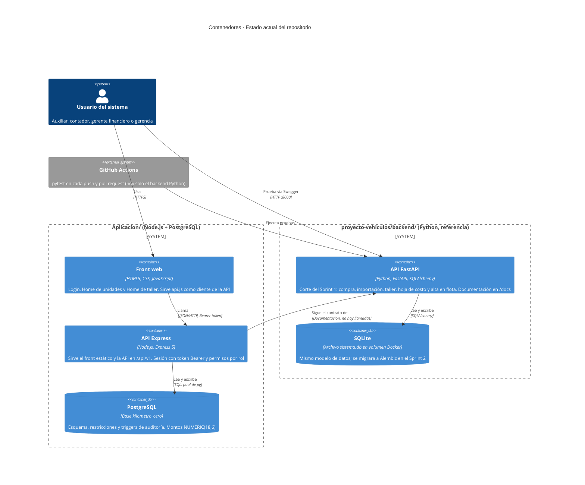
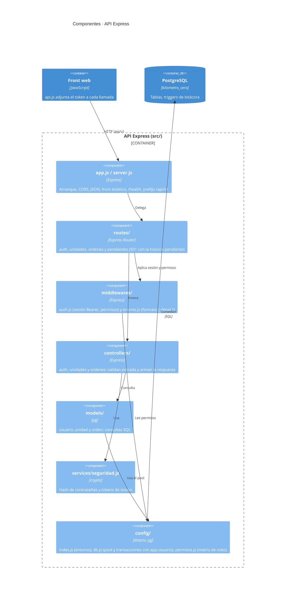
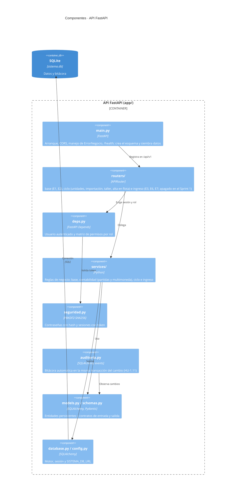

# Arquitectura en modelo C4

Estado al 30/10/2026 (Sprint 1). Los diagramas usan la sintaxis C4 de Mermaid, que GitHub y VS Code (con la extensión de Mermaid) muestran directamente.

Hoy hay **dos implementaciones del backend** con el mismo contrato de API:

| Carpeta | Stack | Base de datos | Papel |
|---|---|---|---|
| `Aplicacion/` | Node.js, Express 5, `pg` | PostgreSQL | Maqueta HTML integrada con un backend con esqueleto (login, unidades y órdenes reales; el resto responde `501`) |
| `proyecto-vehiculos/backend/` | Python, FastAPI, SQLAlchemy | SQLite (archivo en un volumen Docker) | Prototipo técnico del corte del Sprint 1, completo, con pruebas y CI; es la **referencia del contrato** |

## Nivel 1 · Contexto del sistema

## Nivel 2 · Contenedores

## Nivel 3 · Componentes de la API Express (`Aplicacion/`)

## Nivel 3 · Componentes de la API FastAPI (`proyecto-vehiculos/backend/`)

## Decisiones de arquitectura visibles en el código

- **Dos monedas sin punto flotante**: los montos son `NUMERIC(18,6)` en PostgreSQL y `Decimal` en Python; viajan como texto y el navegador no calcula con ellos.
- **Autorización en el servidor**: la matriz de permisos vive en un solo lugar por backend (`config/permisos.js` y `deps.py`); ocultar opciones en el front no sustituye esa validación.
- **Auditoría automática** en la capa de persistencia (triggers en PostgreSQL, eventos de SQLAlchemy en Python), dentro de la misma transacción.
- **Contrato compartido**: ambas APIs exponen `/api/v1` y devuelven errores como `{ "detail": ... }`.

## Puntos abiertos

1. Hay dos backends con la misma responsabilidad y esquemas distintos (`database/schema.sql` frente a `models.py`). Conviene decidir cuál es el definitivo antes del Sprint 2.
2. La integración con FEL y con el tipo de cambio del Banguat no existe todavía.
3. La CI solo prueba el backend Python; el de Node tiene una prueba de humo sin pipeline.
4. El workflow vive en `proyecto-vehiculos/.github/`, así que GitHub no lo ejecuta (solo lee `.github/` en la raíz del repositorio).
