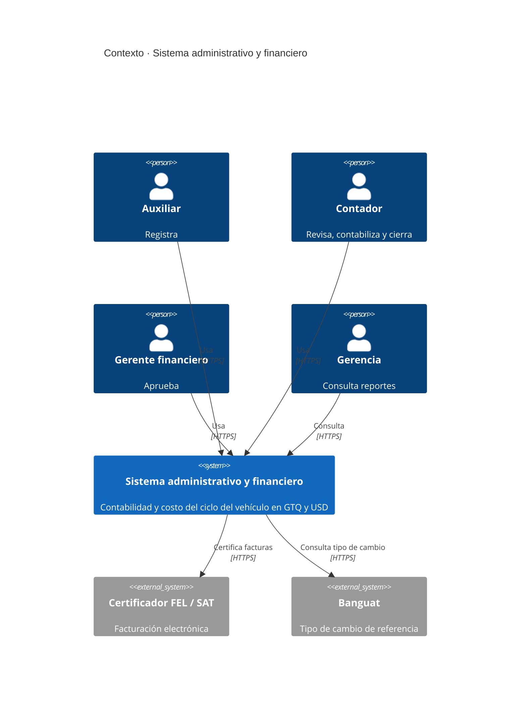
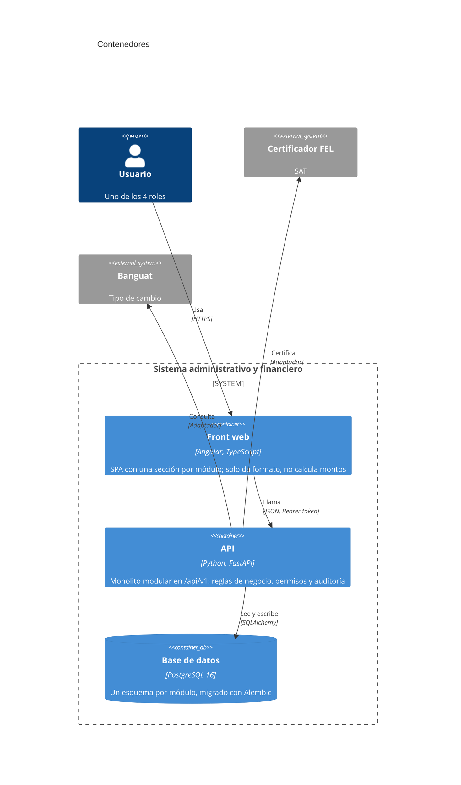
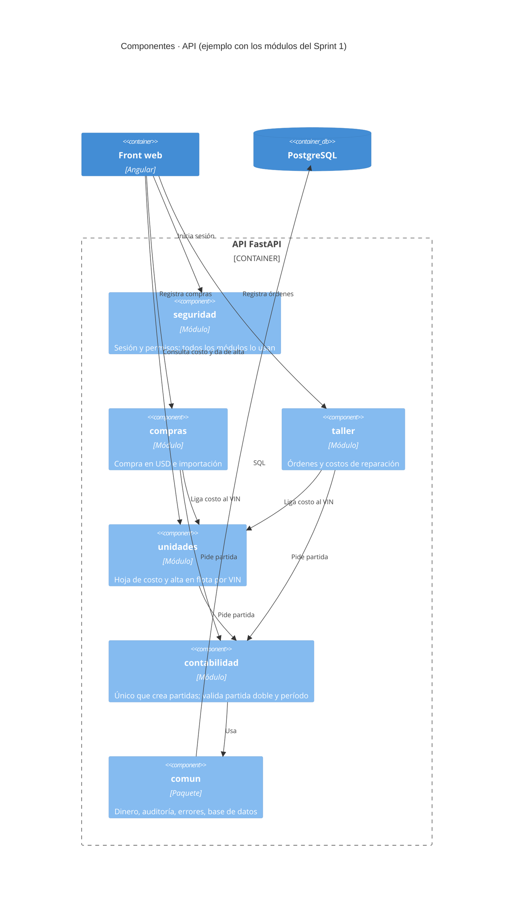

# Arquitectura

31/10/2026 · **Arquitectura vigente del sistema**, construida y verificada en el Sprint 0 ([Sprint0-HelloWorld.md](Sprint0-HelloWorld.md)). Las decisiones están en la sección 8; el estado anterior a la reestructura se conserva en [Old/Arquitectura-C4-previa.md](Old/Arquitectura-C4-previa.md).

## 1. Principios

| Principio | Qué significa aquí |
|---|---|
| **Un solo sistema** | Un backend, una base de datos, un esquema. Se acaban las dos implementaciones paralelas. |
| **Monolito modular** | Una sola API desplegable, dividida en módulos por épica. Para un equipo pequeño y 4 usuarios, los microservicios solo agregan costo; los módulos con límites claros permiten separarlos después si hiciera falta. |
| **La contabilidad es el núcleo** | Ningún módulo escribe partidas directamente: le pide al módulo de contabilidad que las genere. Así las reglas (partida doble, multimoneda, período abierto) viven en un solo lugar. |
| **El VIN es el hilo conductor** | Compra, importación, taller, alta, alquiler y venta se ligan a la unidad. |
| **Sin punto flotante** | `NUMERIC(18,6)` en la base, `Decimal` en Python, montos como texto en JSON. |
| **Seguridad y auditoría en el servidor** | Permisos por rol en la API (no en el front) y bitácora automática en la misma transacción. |
| **Integraciones detrás de adaptadores** | FEL y Banguat se consumen mediante una interfaz; mientras no existan, un adaptador manual o simulado cumple el contrato. |

## 2. Stack

| Capa | Elección | Por qué |
|---|---|---|
| Backend | Python 3.13, FastAPI, SQLAlchemy 2, Pydantic | Ya cubre el corte del Sprint 1 con pruebas; `Decimal` nativo; documentación OpenAPI automática |
| Base de datos | PostgreSQL 16 + Alembic | Transacciones, `NUMERIC`, `JSONB` para la bitácora; migraciones versionadas desde el Sprint 2 |
| Frontend | Angular (versión estable actual) con TypeScript, componentes standalone y formularios reactivos | Pensado para aplicaciones administrativas con muchos formularios y tablas; estructura y convenciones fijas que ayudan a que todos los equipos trabajen igual; tipado de punta a punta con la API |
| Infraestructura | Docker Compose (web, api, db), GitHub Actions | Ambiente reproducible para todo el equipo y CI en cada push |

Los dos prototipos anteriores (Express con PostgreSQL y FastAPI con SQLite) se retiraron del repositorio. Se pueden consultar con la etiqueta de git `legacy-prototipos`: la maqueta HTML/CSS es la referencia visual de los componentes, y `schema.sql` (triggers, restricciones) y la matriz de permisos sirven de insumo al backend.

### Por qué PostgreSQL

| Necesidad del sistema | PostgreSQL | Alternativas |
|---|---|---|
| Montos exactos en GTQ y USD | `NUMERIC(18,6)` exacto, sin redondeos | MySQL también lo tiene; MongoDB no tiene un decimal tan cómodo para sumar y agrupar |
| Partidas que se graban completas o no se graban | Transacciones ACID y restricciones (`CHECK`, llaves foráneas) | MongoDB complica las transacciones entre colecciones; SQLite no soporta bien varios usuarios escribiendo |
| Bitácora con valores anteriores y nuevos | `JSONB` indexable y triggers | MySQL tiene `JSON`, con menos operadores e índices |
| Reportes de rentabilidad por unidad y línea | Vistas, vistas materializadas, funciones de ventana | SQL Server lo hace igual de bien, pero tiene licencia |
| Costo y hospedaje | Libre; servicio administrado en cualquier nube (RDS, Cloud SQL, Azure, Supabase, Neon) | SQL Server y Oracle tienen licencia |

Además, el prototipo Express ya lo usaba, así que su esquema y sus triggers sirven de referencia.

## 3. Nivel 1 · Contexto



## 4. Nivel 2 · Contenedores



En desarrollo, `ng serve` reenvía `/api` a la API con `proxy.conf.json`. En producción, Nginx sirve el build de Angular y reenvía `/api` a la API. En ambos casos el navegador habla con un solo origen y no hace falta abrir CORS.

## 5. Nivel 3 · Módulos de la API

Cada módulo corresponde a una o más épicas y tiene las mismas cuatro capas.

| Módulo | Épicas | Responsabilidad |
|---|---|---|
| `seguridad` | E1 | Usuarios, roles, sesiones, permisos |
| `configuracion` | E1 | Empresa, monedas, tipo de cambio, catálogos, líneas de negocio |
| `contabilidad` | E2 | Catálogo de cuentas, partidas, períodos, cierres, libros |
| `unidades` | E3 | Ficha por VIN, hoja de costo, alta en flota, activos y depreciación |
| `compras` | E4 | Compras en EE. UU., importación, DUCA, cuentas por pagar |
| `taller` | E5 | Órdenes de trabajo, repuestos y mano de obra |
| `facturacion` | E6 | Clientes, FEL, cuentas por cobrar |
| `alquileres` | E3 | Contratos y cobros de alquiler |
| `ventas` | E8 | Venta de unidades, precios, comisiones y margen (Release 2) |
| `financiamiento` | E9 | Créditos propios, amortización, intereses, cuotas, mora y cartera (Release 2) |
| `arranque` | E10 | Plantillas y carga inicial de saldos, flota, terceros y contratos; conciliación del arranque |
| `reportes` | E7 | Rentabilidad por unidad y por línea, tableros de gerencia (solo lectura); compartido entre equipos |
| `comun` | — | Dinero y redondeo, auditoría, errores, conexión a la base, adaptadores externos |



### Capas dentro de cada módulo

```
modulos/compras/
├── router.py       Endpoints HTTP; valida con schemas y exige permisos
├── schemas.py      Contratos de entrada y salida (Pydantic)
├── service.py      Reglas de negocio; única puerta de entrada para otros módulos
└── models.py       Tablas (SQLAlchemy)
```

**Reglas de dependencia**

1. `router` → `service` → `models`. Un router nunca toca la base directamente.
2. Un módulo solo llama al `service.py` de otro módulo, nunca a sus `models`. Eso es lo que permite separarlo después.
3. Solo `contabilidad` escribe partidas. Solo `seguridad` decide permisos.
4. `reportes` solo lee.
5. `comun` no depende de ningún módulo.

### Organización del front (Angular)

El front replica los mismos módulos que la API, para que cada desarrollador trabaje "de punta a punta" en uno.

```
frontend/src/app/
├── core/                    Se carga una vez para toda la aplicación
│   ├── auth/                servicio de sesión, interceptor que agrega el token, guard por rol
│   ├── api/                 cliente HTTP y modelos TypeScript del contrato
│   └── layout/              barra superior, menú lateral según el rol
├── shared/                  Componentes y utilidades sin lógica de negocio
│   ├── components/          tabla, campo de monto, selector de moneda, confirmación
│   └── pipes/               formato de montos (GTQ/USD) y fechas
├── features/                Una carpeta por módulo, con carga diferida (lazy loading)
│   ├── seguridad/           login, usuarios
│   ├── compras/
│   ├── taller/
│   ├── unidades/
│   ├── contabilidad/
│   └── reportes/
├── app.routes.ts            rutas por módulo, protegidas con el guard de rol
└── app.config.ts
```

**Reglas del front**

1. Un componente nunca llama a `HttpClient` directamente: usa el servicio de su módulo (`features/compras/compras.service.ts`).
2. Los montos llegan como texto y se muestran con el pipe de formato; el front no suma ni convierte monedas.
3. El guard de rol solo oculta pantallas; la autorización real sigue en la API.
4. Los modelos TypeScript se generan desde el OpenAPI de FastAPI (por ejemplo con `openapi-typescript`), así el contrato no se desincroniza.

## 6. Estructura del repositorio

```
/
├── backend/
│   ├── app/
│   │   ├── main.py                crea la API y registra los módulos en /api/v1
│   │   ├── comun/                 config, db, dinero, errores (y luego auditoría y adaptadores)
│   │   └── modulos/               un paquete por módulo (sección 5)
│   ├── migrations/                Alembic
│   ├── tests/
│   ├── pyproject.toml             configuración de ruff y pytest
│   ├── Dockerfile
│   └── requirements.txt · requirements-dev.txt
├── frontend/                      proyecto Angular (sección 5)
│   ├── src/app/                   core/, shared/, features/
│   ├── proxy.conf.json            /api → backend en desarrollo
│   ├── nginx.conf                 sirve el build y reenvía /api en producción
│   └── Dockerfile · package.json
├── docs/
│   ├── arquitectura/              este documento y lo construido en el Sprint 0
│   ├── planning/                  épicas, historias, plan del MVP, sprints y sprints.json
│   └── herramientas/              generador del plan y de los PDF
├── .github/                       CI, CODEOWNERS y plantilla de pull request
├── CONTRIBUTING.md                flujo de trabajo del equipo
├── CLAUDE.md · AGENTS.md          guía para agentes de código
├── docker-compose.yml             web + api + db
└── README.md · .env.example · .editorconfig
```

## 7. Cómo escala

| Si crece… | Respuesta, sin rehacer la arquitectura |
|---|---|
| El número de usuarios | La API no guarda estado en memoria (las sesiones están en la base): se levantan más réplicas detrás del proxy |
| Los reportes pesan | Vistas materializadas o una réplica de lectura de PostgreSQL para `reportes` |
| Hay procesos largos (cierre, carga inicial, FEL por lotes) | Se agrega un worker con cola (por ejemplo, Redis + RQ) que reutiliza los mismos `service.py` |
| Un módulo necesita vida propia | Gracias a la regla 2, se extrae con su `service.py` como API aparte |
| Las pantallas crecen | Cada módulo de Angular se carga solo cuando se usa (lazy loading), así el tamaño inicial no crece con el sistema |

## 8. Decisiones

Cada decisión de arquitectura se registra aquí con su estado. Una decisión nueva entra como **Pendiente**, se discute en la planeación o en K1 y pasa a **Aceptada** o **Rechazada** con su fecha.

| # | Decisión | Estado |
|---|---|---|
| ADR-01 | Monolito modular con FastAPI | Aceptada · 30/10/2026 |
| ADR-02 | PostgreSQL 16 + Alembic; no se admite otro motor | Aceptada · 30/10/2026 |
| ADR-03 | Se retiran los prototipos anteriores; la maqueta HTML queda como referencia visual | Aceptada · 30/10/2026 |
| ADR-04 | Solo `contabilidad` crea partidas | Aceptada · 30/10/2026 |
| ADR-05 | Integraciones externas detrás de adaptadores | Aceptada · 30/10/2026 |
| ADR-06 | Front en Angular, organizado por los mismos módulos que la API | Aceptada · 30/10/2026 |
| ADR-07 | Auditoría con eventos de SQLAlchemy o con triggers de PostgreSQL | Pendiente · K1 (02/11/2026) |
| ADR-08 | Librería de componentes de Angular (tabla, formulario y árbol) | Pendiente · K1 (02/11/2026) |
| ADR-09 | Ambiente de pruebas desplegado desde `main` | Pendiente · K1 (02/11/2026) |
| ADR-10 | Herramienta de prueba de punta a punta en CI | Pendiente · K1 (02/11/2026) |

La migración desde los prototipos anteriores está terminada: ver [Sprint0-HelloWorld.md](Sprint0-HelloWorld.md).
